<!-- ===== Animated wave header ===== -->


<!-- ===== Animated typing text ===== -->
<p align="center">
  <a href="https://github.com/Rao-Saad-Aziz">
    
  </a>
</p>

<p align="center">
  
  <a href="https://github.com/Rao-Saad-Aziz?tab=followers"></a>
</p>


##  About Me

<table>
<tr>
<td width="60%">

```python
class RaoSaadAziz:
    def __init__(self):
        self.role      = "AI / ML Intern"
        self.backend   = ["Python", "Django", "FastAPI", "SQL"]
        self.frontend  = ["React", "TypeScript", "JavaScript", "HTML", "CSS"]
        self.creative  = ["Graphic Design", "Video Editing", "After Effects"]
        self.learning  = "Machine Learning & LLM apps"
        self.contact   = "raosaadaziz456@gmail.com"

    def say_hi(self):
        print("Thanks for dropping by! Let's build something cool 🚀")

me = RaoSaadAziz()
me.say_hi()
```

</td>
<td width="40%" align="center">
  
</td>
</tr>
</table>

- 🤖 Working as an **AI/ML Intern**, building LLM-powered tools
- 🐍 Building backends and APIs with **Python, Django & FastAPI**
- ⚛️ Creating frontends with **React & TypeScript**
- 🎨 **Graphic designer & video editor**: motion graphics in **After Effects**
- 📫 Reach me at **raosaadaziz456@gmail.com**


## ⚡ Tech Stack

<p align="center"><b>🤖 AI / ML & Backend</b></p>
<p align="center">
  
</p>

<p align="center"><b>🌐 Frontend</b></p>
<p align="center">
  
</p>

<p align="center"><b>🗄️ Database</b></p>
<p align="center">
  
</p>

<p align="center"><b>🎨 Design & Video</b></p>
<p align="center">
  
</p>

<p align="center"><b>🧰 Tools</b></p>
<p align="center">
  
</p>


## 🚀 Featured Projects

<table>
<tr>
<td>

### 🧠 [DocMind](https://github.com/Rao-Saad-Aziz/DocMind)
AI document Q&A assistant: ask questions about company documents and get answers **with document and page citations**. Includes **role-based access** (intern / staff / HR / admin), so confidential files stay protected.


</td>
</tr>
</table>


## 📊 GitHub Stats

<p align="center">
  
  
</p>

<p align="center">
  
</p>

<p align="center">
  
</p>

## 🦖 Dino Run

<p align="center">
  
</p>

## 🐍 Contribution Snake

<p align="center">
  <picture>
    <source media="(prefers-color-scheme: dark)" srcset="https://raw.githubusercontent.com/Rao-Saad-Aziz/Rao-Saad-Aziz/output/github-contribution-grid-snake-dark.svg" />
    <source media="(prefers-color-scheme: light)" srcset="https://raw.githubusercontent.com/Rao-Saad-Aziz/Rao-Saad-Aziz/output/github-contribution-grid-snake.svg" />
    
  </picture>
</p>


## 🤝 Connect With Me

<p align="center">
  <a href="https://www.linkedin.com/in/saad-aziz-660641315/" target="_blank"></a>
  <a href="mailto:raosaadaziz456@gmail.com"></a>
  <a href="https://www.instagram.com/saadio.xom" target="_blank"></a>
</p>

<p align="center">
  
</p>

<!-- ===== Animated wave footer ===== -->

